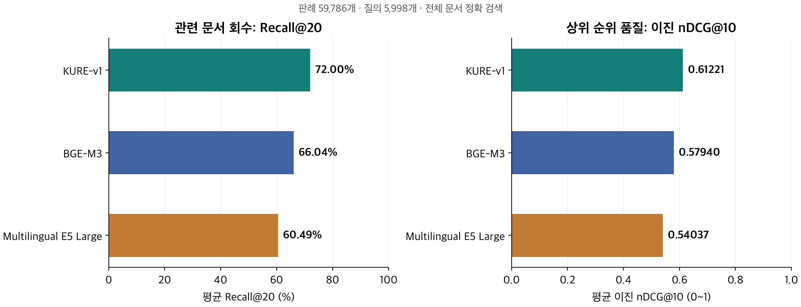

# 한국어 판례 임베딩 검색 비교

[전체 실험 목록](../README.md)

- 상태: 전체 평가 완료 (2026-10-20), 이진 nDCG 재검증 완료 (2026-10-23)
- 목적: 동일한 한국어 판례·질의·정답으로 임베딩 모델의 관련 문서 검색 성능을 비교합니다.
- 구현: `src/llm_benchmark/embedding/`
- 테스트: `tests/embedding/`
- 설정: [legal_recall.yaml](../../../configs/legal_recall.yaml)

**문서 단위 Recall@K·이진 nDCG@K 평가와 분석을 완료했습니다.** 비교한 세 모델 중 **KURE-v1이 두 지표 모두 모든 K에서 가장 높아**, 이번 한국어 판례 검색의 기본 모델로 선택했습니다.

## 최신 평가 결과

2026-10-20 실행한 EVE-Bench-Legal-2.0 전체 평가 결과입니다. 판례 **59,786개**와 고유 질의 **5,998개**를 사용했고, 평가에서 제외된 질의는 없습니다.

| 모델 | Recall@1 | Recall@5 | Recall@10 | Recall@20 | Recall@50 | Recall@100 |
| --- | ---: | ---: | ---: | ---: | ---: | ---: |
| **KURE-v1** | **18.36%** | **41.35%** | **55.51%** | **72.00%** | **85.82%** | **92.17%** |
| BGE-M3 | 17.50% | 39.32% | 52.38% | 66.04% | 80.95% | 88.70% |
| Multilingual E5 Large | 16.82% | 37.13% | 48.53% | 60.49% | 74.41% | 82.83% |

같은 검색 순위로 계산한 **이진 nDCG**는 관련 판례가 얼마나 앞에 배치되었는지를 평가합니다. 값은 백분율이 아닌 0~1 점수입니다.

| 모델 | nDCG@1 | nDCG@5 | nDCG@10 | nDCG@20 | nDCG@50 | nDCG@100 |
| --- | ---: | ---: | ---: | ---: | ---: | ---: |
| KURE-v1 | **0.81594** | **0.61369** | **0.61221** | **0.67081** | **0.72516** | **0.74510** |
| BGE-M3 | 0.77859 | 0.58248 | 0.57940 | 0.62496 | 0.68324 | 0.70776 |
| Multilingual E5 Large | 0.74175 | 0.54993 | 0.54037 | 0.57941 | 0.63369 | 0.66070 |



Recall은 관련 문서 회수율, 이진 nDCG는 관련 문서의 상위 배치를 평가합니다. 이번 nDCG는 relevance > 0을 모두 1로 처리하므로 관련성 등급 간 차이를 반영하지 않습니다. 같은 K에서 모델을 비교하며, nDCG는 K가 커져도 반드시 증가하지 않습니다.

KURE-v1은 BGE-M3보다 Recall@20이 **5.96%p** 높았고, 입력이 잘린 문서도 없었습니다. E5는 문서 **13.67%**가 512토큰 제한으로 잘렸습니다. 이번 선택은 모델별 공식 입력 규칙과 길이 제한을 적용한 문서 단위 검색 결과에 근거합니다.

Recall은 질의마다 관련 판례 중 검색한 비율을 계산한 뒤 평균한 값입니다. **Recall@100 92.17%가 답변 정확도 92.17% 또는 모든 정답을 찾은 질의 비율을 뜻하지는 않습니다.** 생성 답변 품질과 운영 검색 지연시간은 이번 실험의 평가 대상에 포함하지 않았습니다.

테스트 목적, 결과 해석, 입력 잘림과 실행 시간, 선택 근거의 적용 범위는 [결과 보고서](../results/2026-10-20-embedding-recall.md)에 정리했습니다.

세 모델은 로컬 Mac mini M2·16GB 메모리 환경의 자원 제약을 고려해 선정했습니다. 약 5.6억 파라미터 규모의 로컬 실행 가능한 후보를 비교한 것으로, 최신 한국어 검색 상위 세 모델을 비교한 결과는 아닙니다.

## 평가 방식

```text
Corpus · Queries · Qrels 검증
  → 모델별 문서·질의 임베딩
  → 전체 Corpus의 cosine 정확 검색
  → Recall@K·이진 nDCG@K 계산 및 검증
  → 모델별·질의별 결과 저장
```

| 항목 | 설정 |
| --- | --- |
| 데이터셋 | EVE-Bench-Legal-2.0, 데이터 리비전 고정 |
| 비교 모델 | `BAAI/bge-m3`, `nlpai-lab/KURE-v1`, `intfloat/multilingual-e5-large` |
| 입력 | 제목과 text를 결합해 판례 1개당 벡터 1개 생성 |
| 검색 | 전체 Corpus 대상 Exact Top 100, 정규화 벡터의 cosine |
| 정답 | Qrels에서 relevance > 0인 문서 |
| 지표 | K=1/5/10/20/50/100의 Recall·이진 nDCG, 질의별 산술평균 |
| 검증 | Recall 실행 시 MTEB 비교, 두 지표의 저장값 대조와 순위 기반 재계산 |

모델·데이터 리비전과 실행 조건은 [configs/legal_recall.yaml](../../../configs/legal_recall.yaml)에 고정합니다. 중복 질의는 관련 문서 합집합·최대 등급을 보존하는 `merge_max` 정책으로 병합합니다. 청킹, ANN/HNSW, Hybrid Search, Reranker는 이번 평가에 포함하지 않았습니다.

## 설치와 실행

Python **3.11 이상 3.15 미만**과 uv가 필요합니다. 기존 실행 환경은 Python 3.12로 검증했습니다. 아래 명령은 프로젝트 루트에서 실행합니다.

```bash
uv sync --locked --extra embedding --cache-dir cache/uv

# 데이터 다운로드와 정합성 검증
.venv/bin/embedding-benchmark download
.venv/bin/embedding-benchmark prepare

# 실제 문서·질의 각 2개로 모델 추론 확인
.venv/bin/embedding-benchmark probe

# 전체 데이터로 세 모델의 Recall 비교
.venv/bin/embedding-benchmark run
```

모델은 Hugging Face에서 내려받고 임베딩·검색·평가는 로컬에서 실행합니다. `probe`는 추론 동작 확인용이며 Recall 평가 점수를 생성하지 않습니다. `run`은 질의 제한 없이 실행하면 전체 데이터를 평가합니다.

특정 모델만 평가하거나 실행 장치와 배치 크기를 지정할 수 있습니다.

```bash
.venv/bin/embedding-benchmark run --models kure-v1
.venv/bin/embedding-benchmark run --models kure-v1 --device mps --batch-size 4
```

`--query-limit 10`처럼 질의를 제한해도 검색 Corpus는 전체를 유지합니다. 최초 실행의 문서 임베딩 비용은 줄지 않습니다. 설치 방법과 옵션 설명은 [실행 안내](../../engineering/running.md)를 참조하세요.

## 결과와 캐시

```text
results/<run_id>/
  manifest.json          # 설정·버전·실행 상태·잘림 통계
  recall_summary.csv     # 모델별 Recall 비교
  raw/                   # 모델별 MTEB 원본 결과(Recall·nDCG 등)
  per_query/             # 질의별 검색 문서·점수·Recall

results/probes/          # 소량 실제 추론 확인 보고서
cache/embeddings/        # 문서·질의 벡터 캐시
```

평가 결과는 **모델 하나의 평가가 끝날 때마다** 저장합니다. 임베딩 캐시는 **문서 또는 질의 집합 전체 인코딩이 끝나야** 저장하므로, 처리 중인 집합의 중간 재시작은 지원하지 않습니다. 전체 실행은 소량 추론 확인보다 오래 걸립니다.

원본 데이터·모델·캐시·실행 결과는 Git 추적에서 제외합니다. 공유할 평가 결과와 모델 선택 근거는 `docs/benchmarks/results/`의 Markdown 보고서로 관리합니다.

## 관련 문서

- [평가 설계와 지표 정의](../embedding-recall.md)
- [상세 결과와 모델 선택 근거](../results/2026-10-20-embedding-recall.md)
- [모델 입력 규칙과 리비전](../../engineering/models.md)
- [EVE 데이터 구조와 정답 관리](../../domain/legal/dataset.md)
- [설치·실행 옵션과 실패 처리](../../engineering/running.md)
