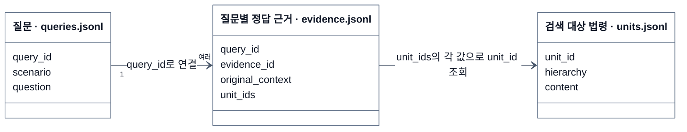

# KoBLEX 데이터 관계

[실험 안내](README.md) · [실행 결과](results-2026-10-24.md)

**질문에 붙은 정답 근거를 검색 대상 법령의 본문과 연결합니다.**

- **질문**: 사건 배경과 물어보는 내용입니다.
- **정답 근거**: 원본 QA의 `contexts`에 주석된, 그 질문에 필요한 법령 내용입니다.
- **법령**: 검색 대상 코퍼스에 들어 있는 법령 본문입니다. 근거와 본문이 일치하는 항목을 찾아 연결합니다.

근거 하나가 법령 여러 항목으로 구성될 수도 있습니다. 그때는 `unit_ids`에 필요한 항목 ID를 모두 기록합니다. 연결되지 않은 근거는 이 목록이 비어 있습니다.

생성한 **정답표 `qrels.json`**은 평가 가능한 질문의 `질문 ID → 근거 ID → 법령 ID 목록`을 저장합니다. **분할 `splits.jsonl`**은 질문을 개발용·최종 평가용·보류로 구분합니다.
