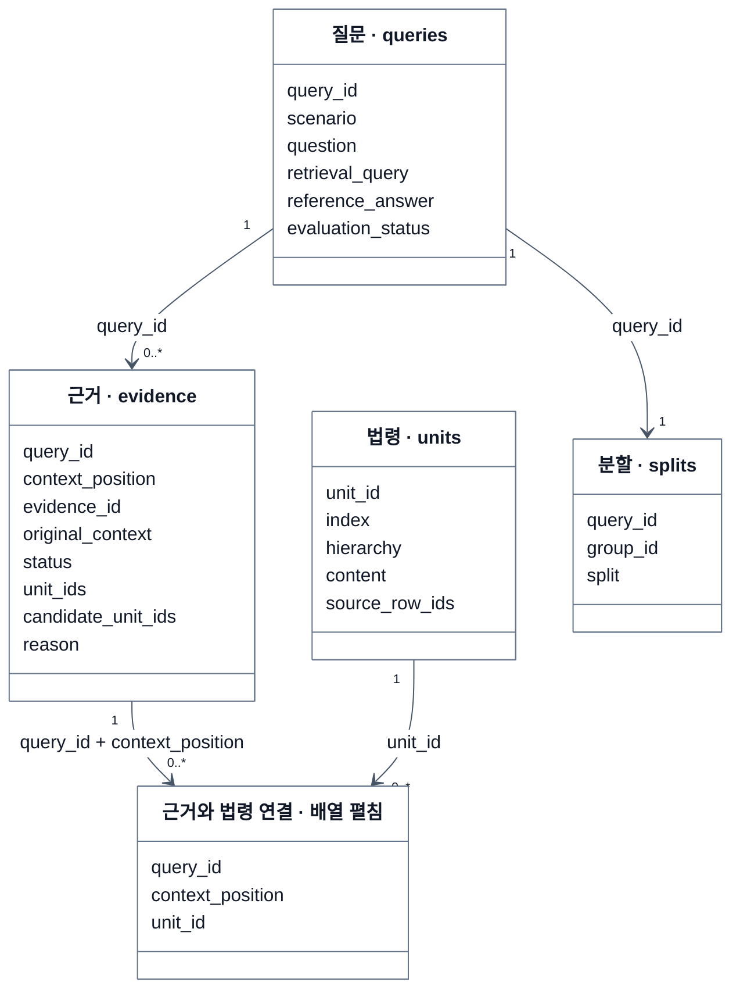

# KoBLEX 데이터 흐름

[실험 안내](README.md) · [실행 결과](results-2026-10-24.md)

질문의 정답 근거를 법령 본문에 연결해 정답표와 테스트셋을 생성합니다. 아래는 JSON·JSONL 데이터를 테이블 형태로 표현한 관계도입니다.

질문 하나에 여러 근거가 연결되고, 근거 하나는 여러 법령 항목으로 구성될 수 있습니다. 질문별 사용 구분은 `splits`에 저장합니다.

`EVIDENCE_UNIT`은 `unit_ids` 배열을 펼친 모습이며 별도 저장 파일은 아닙니다.
