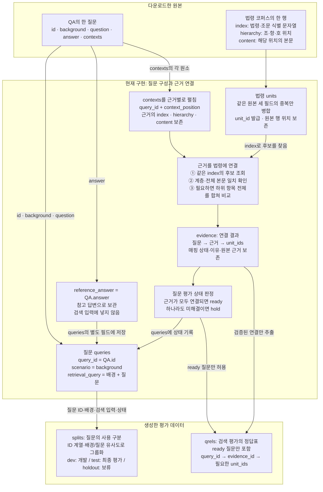
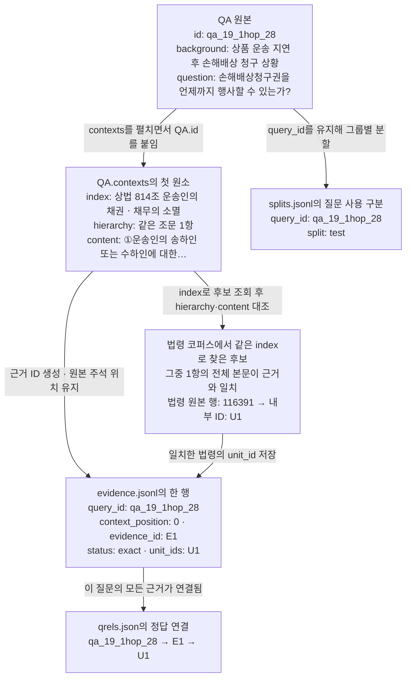

# KoBLEX 데이터 흐름

[실험 안내](README.md) · [실행 결과](results-2026-10-24.md) · [평가 규칙](evaluation-rules.md)

입력은 **질문·참고 답변·정답 근거가 들어 있는 QA**와 **검색 대상인 법령 코퍼스**입니다. QA의 근거 본문을 코퍼스의 실제 법령 항목에 연결해, 나중에 검색기가 무엇을 찾아야 정답인지 기록합니다.

## 어떤 데이터가 어디로 가는가

`answer`는 참고 답변, `contexts`는 원본에 주석된 정답 근거, 법령 코퍼스는 검색 대상입니다. **정답 근거를 질의에 섞지 않습니다.** 매핑은 LLM 추론이나 벡터 유사도로 결정하지 않고 문자열의 전체 일치로 검증합니다.

## 실제 한 질문을 따라가기

다음은 `qa_19_1hop_28`의 첫 근거입니다. 긴 해시 ID는 읽기 쉽게 `E1`(근거), `U1`(법령)의 별칭으로 표시했습니다. 본문도 도식에서만 줄였으며 실제 비교는 전체 본문으로 수행합니다.

즉, 원본 두 파일에 공통 `unit_id`가 있는 것이 아닙니다. 법령 정규화 때 `unit_id`, 근거를 펼칠 때 `evidence_id`를 만들고, **문자열 매핑이 성공한 근거에 해당 unit_id를 기록해 이후 ID로 조인**합니다. 실제 해시는 [매핑 장부](mapping-ledger.json)에서 질문 ID로 찾을 수 있습니다.

## 저장 파일을 조인해서 읽는 방법

로컬 출력 위치는 `data/prepared/koblex-v1/`입니다. 원본 위치는 `data/raw/koblex/`이며 행 번호는 0부터 시작합니다.

| 파일 | 한 행·값의 의미 | 주요 스키마와 연결 |
| --- | --- | --- |
| `queries.jsonl` | 하나의 질문과 검색 입력 | `query_id: string` → 원본 QA.id. `scenario`, `question`, `retrieval_query`, `reference_answer: string`, `evaluation_status: ready/hold` |
| `evidence.jsonl` | 질문에 달린 근거 주석 하나의 매핑 결과 | 행 키 `(query_id: string, context_position: int)`. `evidence_id: string`, `original_context: object`, `status: string`, `unit_ids: list<string>` |
| `units.jsonl` | 원문을 보존한 하나의 법령 항목 | `unit_id: string`, `index`, `hierarchy`, `content: string`, `source_row_ids: list<int>` |
| `qrels.json` | 평가 가능한 질문의 근거별 정답 법령 목록 | `{query_id: {evidence_id: [unit_id, ...]}}` |
| `splits.jsonl` | 질문의 개발·최종 평가·보류 구분 | `query_id`, `group_id: string`, `split: dev/test/holdout`, `source_split: 원본 분할` |

1. `queries.query_id = splits.query_id`로 평가할 질문을 고릅니다.
2. 같은 `query_id`로 qrels의 정답 근거를 읽거나 evidence의 매핑 과정을 조회합니다.
3. 근거의 `unit_ids` 배열을 펼쳐 `units.unit_id`와 조인하면 법령 원문을 얻습니다.

질문 하나에 근거 여러 개가 붙고, 근거 하나가 여러 법령 항목으로 연결될 수 있습니다. 같은 근거가 여러 질문에 재사용될 수도 있습니다. `index`는 후보를 찾는 문자열이며 단독으로 유일한 조인 키가 아닙니다. `candidate_unit_ids`는 후보 전체, `unit_ids`는 검증된 정답 연결입니다.

## 이 결과를 다음 검색 평가에서 어떻게 쓰는가

검색기는 `queries.retrieval_query`로 법령을 찾아 순위와 `unit_id`를 반환하게 됩니다. 평가기는 같은 질문의 **qrels와 검색된 unit_id를 비교**합니다. 근거 E1에 U1·U2가 모두 필요하다면 둘 다 찾아야 E1을 회수한 것으로 셉니다. `reference_answer`는 후속 답변 평가를 위해 보관합니다.

현재 구현은 정답표와 분할을 만드는 단계까지입니다. 실제 검색·생성은 미실행이며, 연결이 안 된 질문은 원본·실패 이유를 보존하고 평가에서 제외합니다. 상세 판정은 [평가 규칙](evaluation-rules.md), 실제 결과는 [재실행 보고서](results-2026-10-24.md)에 있습니다.
